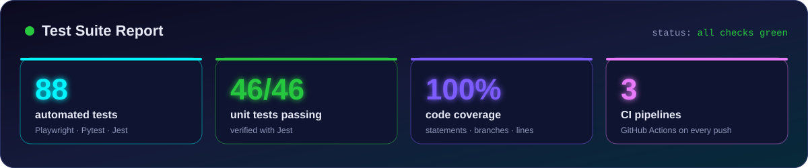
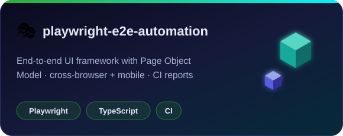
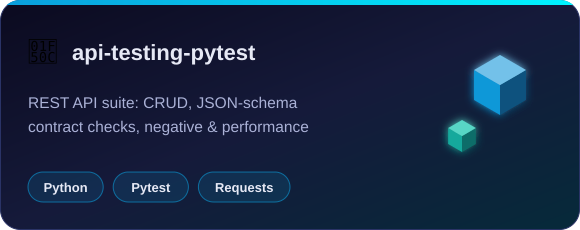
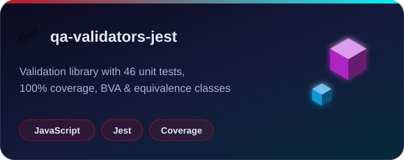
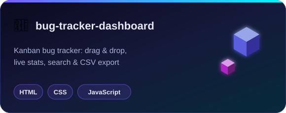
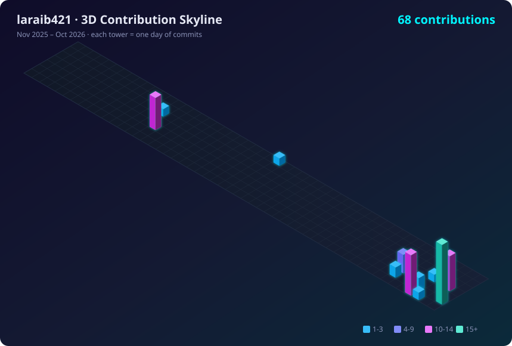

<p align="center">
  
</p>

<p align="center">
  <a href="https://github.com/laraib421"></a>
</p>

<p align="center">
  <a href="https://www.linkedin.com/in/laraib-liaquat-282316216"></a>
  
  
</p>

<br/>

<p align="center">
  
</p>

<h2 align="center">🧑‍💻 About Me</h2>

<table align="center">
<tr>
<td width="55%" valign="top">

```yaml
name: Laraib Liaquat
roles: [QA Engineer, Web Developer]
testing: [E2E UI, API, Unit, Regression]
automation: [Playwright, Pytest, Jest]
ci_cd: GitHub Actions
building: SmartCare — a caring web app
motto: "Quality is a habit, not an act."
```

</td>
<td width="45%" valign="top">

🐞 I hunt bugs before users do<br/>
🎭 I automate UI flows end-to-end<br/>
🔌 I test APIs, contracts & edge cases<br/>
📐 I design tests with BVA & equivalence partitioning<br/>
💻 I build responsive, accessible web apps<br/>
🌱 Always learning, one commit at a time

</td>
</tr>
</table>

<h2 align="center">🧰 Toolkit</h2>

<p align="center">
  
</p>
<p align="center">
  
  
  
  
  
</p>

<h2 align="center">🚀 Featured Projects</h2>

<p align="center">
  <a href="https://github.com/laraib421/playwright-e2e-automation"></a>
  <a href="https://github.com/laraib421/api-testing-pytest"></a>
  <a href="https://github.com/laraib421/qa-validators-jest"></a>
  <a href="https://github.com/laraib421/bug-tracker-dashboard"></a>
</p>

<p align="center">
  <b>More:</b> 🔐 <a href="https://github.com/laraib421/securepass">securepass</a> &nbsp;•&nbsp; 🌍 <a href="https://github.com/laraib421/AQIHyderabad10PEARLS">AQI prediction (Hyderabad)</a>
</p>

<h2 align="center">🏙️ 3D Contribution Skyline</h2>

<p align="center">
  
</p>

<h2 align="center">📊 GitHub Analytics</h2>

<p align="center">
  
  
</p>
<p align="center">
  
</p>

<p align="center">
  
</p>
