<!-- ═══════════════════════════  HERO  ═══════════════════════════ -->

  

  

  <a href="https://www.linkedin.com/in/laraib-liaquat-282316216"></a>
  &nbsp;
  <a href="https://github.com/laraib421"></a>

<!-- ═══════════════════════════  ABOUT  ═══════════════════════════ -->
<h2 align="center">About&nbsp;Me</h2>

  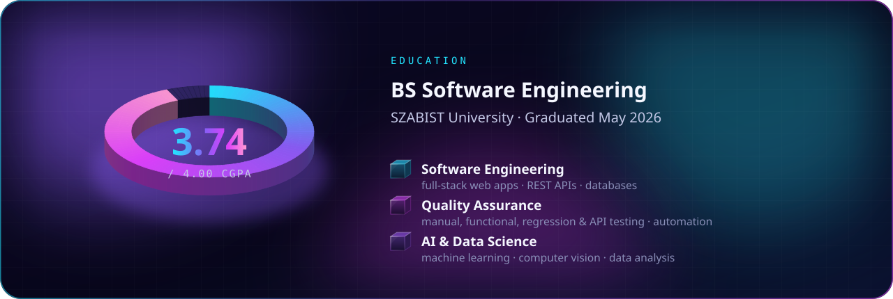

I'm a <b>Software Engineering graduate from SZABIST</b> (CGPA 3.74/4.00, May 2026) who builds software and tests it to production standard. My experience spans <b>software engineering, AI, data science and quality assurance</b>, from Flask and ASP.NET Core back ends and machine-learning pipelines to manual, regression and API testing, plus automated suites in Playwright, Pytest and Jest.
  <i>I care about software that works, reads well and stays reliable after release.</i>

<!-- ═══════════════════════════  STACK  ═══════════════════════════ -->
<h2 align="center">Tech&nbsp;Stack</h2>

  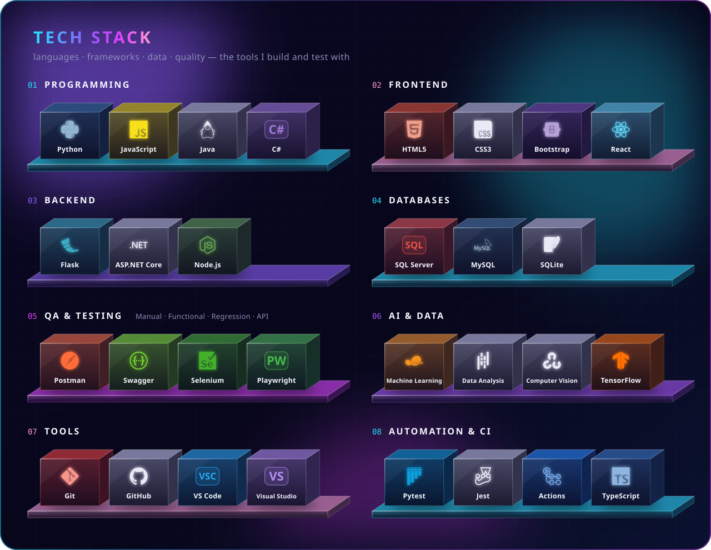

<b>Text version of the stack</b>

 

| Area | Technologies |
|---|---|
| **Programming** | Python · JavaScript · Java · C# |
| **Frontend** | HTML5 · CSS3 · Bootstrap · React |
| **Backend** | Flask · ASP.NET Core · Node.js |
| **Databases** | Microsoft SQL Server · MySQL · SQLite |
| **QA & Testing** | Manual · Functional · Regression · API testing · Postman · Swagger · Selenium · Playwright |
| **AI & Data** | Python · Machine Learning · Data Analysis · Computer Vision · TensorFlow |
| **Automation & CI** | Pytest · Jest · TypeScript · GitHub Actions |
| **Tools** | Git · GitHub · VS Code · Visual Studio |

<!-- ═══════════════════════════  PROJECTS  ═══════════════════════════ -->
<h2 align="center">Featured&nbsp;Projects</h2>

  <a href="https://github.com/laraib421/autism">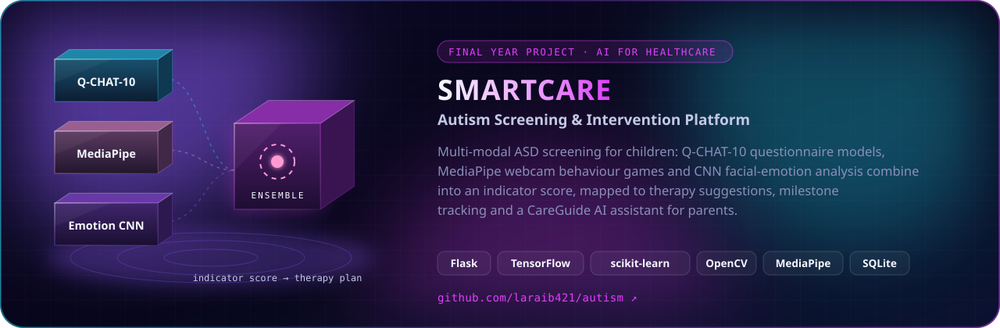</a>

  <a href="https://github.com/laraib421/securepass">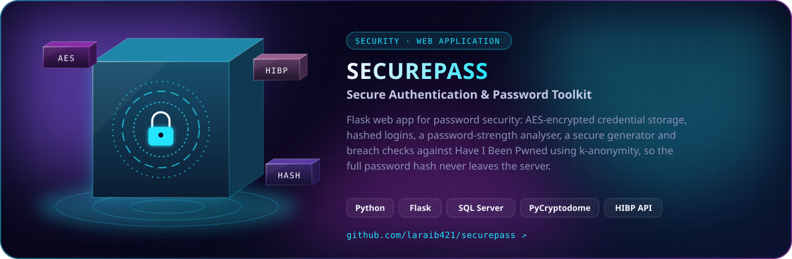</a>

  <a href="https://github.com/laraib421/AQIHyderabad10PEARLS">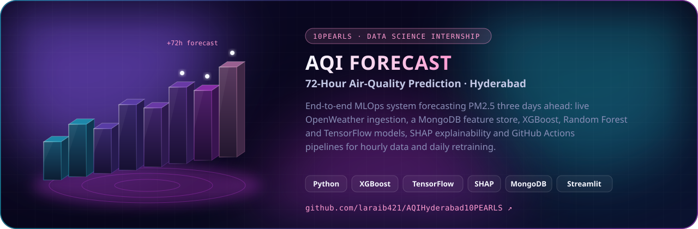</a>

  <a href="https://github.com/laraib421/womenquest26">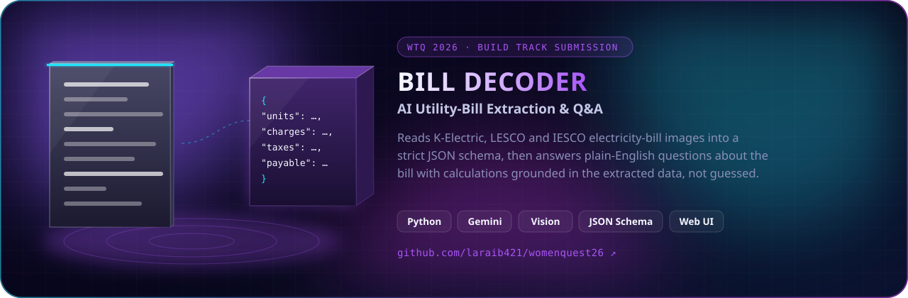</a>

  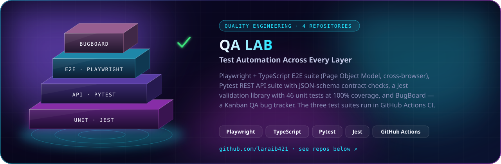

  <a href="https://github.com/laraib421/playwright-e2e-automation">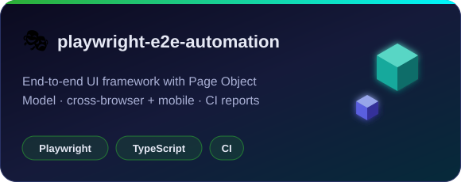</a>
  <a href="https://github.com/laraib421/api-testing-pytest">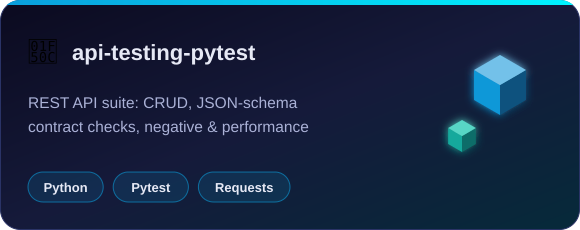</a>
  <a href="https://github.com/laraib421/qa-validators-jest">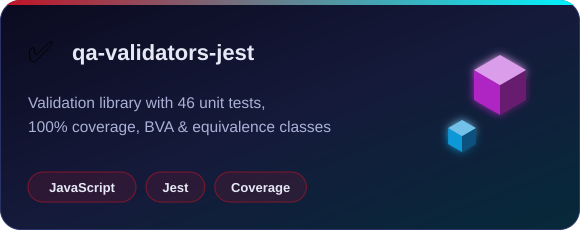</a>
  <a href="https://github.com/laraib421/bug-tracker-dashboard">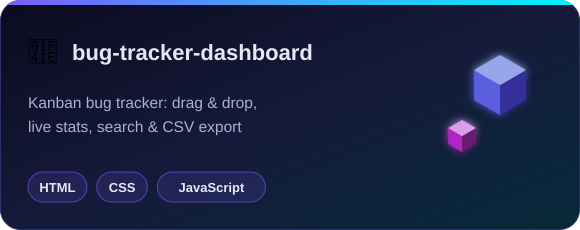</a>

<b>Also built</b> (repositories not public yet)

 

| Project | What it is | Stack |
|---|---|---|
| **Employee API** | Web API with Entity Framework Core data access | ASP.NET Core · Entity Framework Core · SQL Server |
| **Spam Email Detection** | Machine-learning email classification | Python · Machine Learning |
| **Weather Forecasting** | Weather forecasting project | Python · Data Science |
| **Event Management System** | Software application for managing events | — |
| **Laboratory Management System** | Database-driven laboratory management solution | — |

<!-- ═══════════════════════════  EXPERIENCE  ═══════════════════════════ -->
<h2 align="center">Experience</h2>

  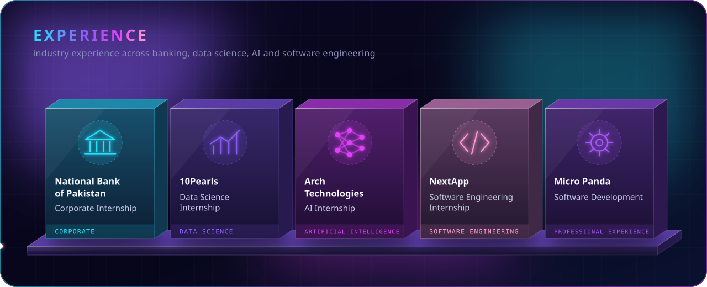

| Organization | Role |
|---|---|
| **National Bank of Pakistan** | Corporate Internship |
| **10Pearls** | Data Science Internship: built the [AQI forecasting system](https://github.com/laraib421/AQIHyderabad10PEARLS) |
| **Arch Technologies** | AI Internship |
| **NextApp** | Software Engineering Internship |
| **Micro Panda** | Professional Software Development Experience |

<!-- ═══════════════════════════  ACTIVITY  ═══════════════════════════ -->
<h2 align="center">GitHub&nbsp;Activity</h2>

  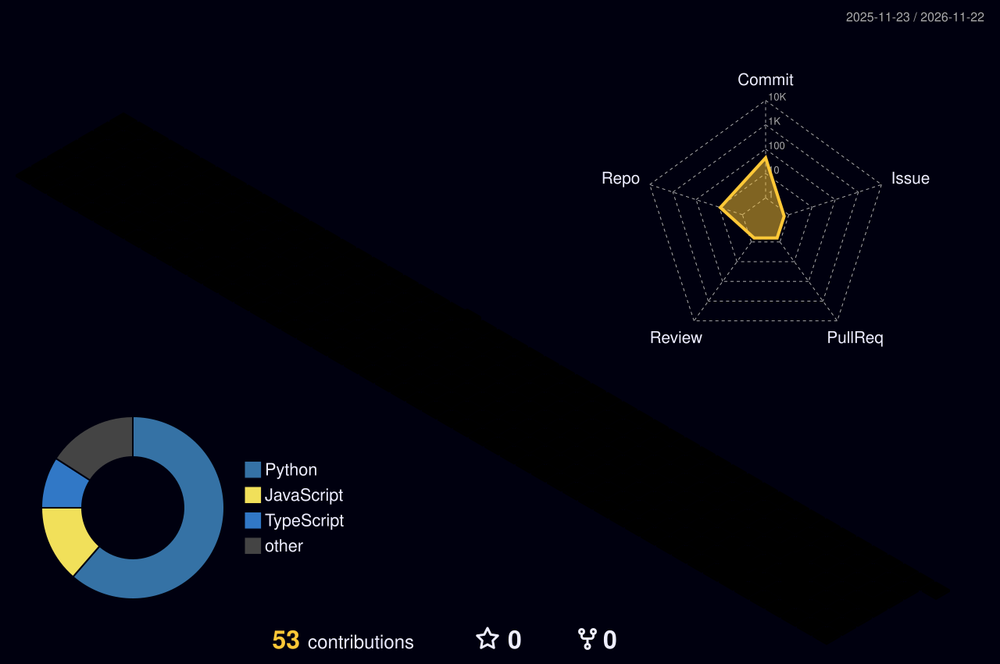

  

The 3D calendar above is generated from live GitHub data every day by <a href=".github/workflows/profile-3d.yml">this workflow</a>.

<!-- ═══════════════════════════  FOOTER  ═══════════════════════════ -->

  

